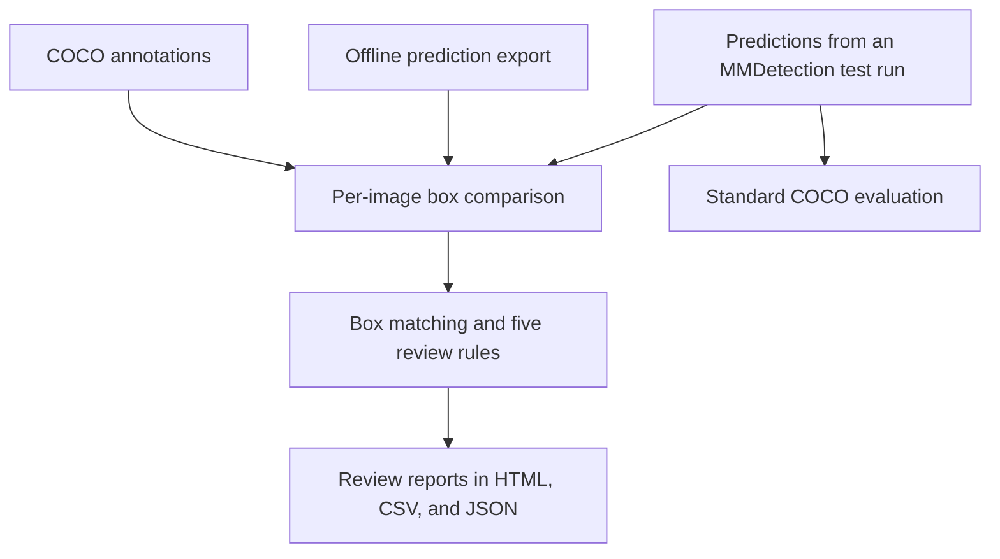

# Traffic Annotation Review

**Quality checks for bounding-box annotations in object detection.**

Traffic Annotation Review compares existing COCO annotations with a detector’s predictions. It flags potential annotation errors and reports the image ID, relevant bounding boxes, and reason for each finding. Annotation teams can use the resulting queue to review affected images before the next training run.

[Quick start](#quick-start) · [Review logic](#review-logic) · [Validation](#validation) · [CSV review report](projects/traffic_annotation_review/validation/controlled_report/review.csv)

## Quick start

The offline demo uses Python, NumPy, SciPy, and the included example files. Run the commands from the repository root.

```bash
python -m venv .venv
```

Activate the environment with `.\.venv\Scripts\Activate.ps1` in Windows PowerShell or `source .venv/bin/activate` on Linux.

```bash
python -m pip install numpy scipy
python -m projects.traffic_annotation_review --annotations projects/traffic_annotation_review/examples/annotations.json --predictions projects/traffic_annotation_review/examples/predictions.bbox.json --out-dir work_dirs/review_demo
```

The demo produces **five review findings**, one per rule. Open `work_dirs/review_demo/review.html` in your browser. The two example JSON inputs contain synthetic box coordinates for a reproducible functional test.

### Review your own data

| Input | Format |
|---|---|
| `--annotations` | A COCO JSON object with `images`, `categories`, and `annotations`. Each image entry includes its filename, width, and height. |
| `--predictions` | A JSON list with `image_id`, `category_id`, `bbox`, and `score` for each prediction. The IDs must match the annotation file. |
| `--out-dir` | The destination directory for the three reports. The review reads the source files without editing them. |

Both inputs use `[x, y, width, height]` in pixels, measured from the upper-left corner of the image. The parser checks for unique IDs, valid image and category references, finite coordinates, positive box dimensions, and scores in the interval `[0, 1]`.

```bash
python -m projects.traffic_annotation_review --annotations data/instances.json --predictions runs/predictions.bbox.json --out-dir work_dirs/traffic_review --min-score 0.70
```

## Review logic



### Bounding-box matching

The extension computes an overlap matrix for each image. **Intersection over Union (IoU)** is the area shared by two boxes divided by the area covered by their union. Identical boxes have an IoU of 1.

1. Predictions with a score of **0.65** or higher are considered for review.
2. Predictions and annotations of the same class with an IoU of at least **0.50** are matched first. The linear assignment maximizes the number of valid pairs, then their total IoU. Each box can be matched at most once, which matters when several objects are close together.
3. A prediction is excluded from further model-based checks when an `iscrowd` or `ignore` box covers at least **50 percent of the prediction’s own area**. This check uses the fraction of the predicted box covered by the ignore region.
4. The algorithm checks the remaining unmatched boxes for class conflicts first, then geometric misalignment. It then checks unmatched predictions for potentially missing annotations. The duplicate and image-boundary rules operate directly on regular annotations.

### The five review rules

| Finding | Default rule |
|---|---|
| `missing_box` · Potentially missing box | An unmatched prediction with an IoU below **0.20** against every regular annotation. |
| `class_conflict` · Class mismatch | An unmatched prediction and annotation with different classes and an IoU of at least **0.65**. |
| `box_alignment` · Box misalignment | An unmatched prediction and annotation of the same class with an IoU of at least **0.20** and below **0.50**. |
| `duplicate_box` · Potential duplicate | Two regular annotations of the same class with an IoU of at least **0.90**. |
| `box_out_of_bounds` · Outside the image | A regular annotation extends beyond the image boundary by more than the numerical tolerance of **0.001 pixels**. |

Detection scores and box overlap provide evidence for a review finding. The reviewer decides whether to correct the annotation by examining the original image. The missing-box rule requires a model prediction. Manual sampling can also uncover objects the detector missed.

### Output and coverage

| Output | Use |
|---|---|
| `review.html` | Local browser report with summary counts and up to 500 findings in the defined order. |
| `review.csv` | Full review queue with a blank `review_decision` column for recording the reviewer’s decision. |
| `review.json` | Structured findings, effective thresholds, category coverage, and evaluation coverage. The offline CLI also records SHA-256 checksums of both inputs. |

Findings are grouped by rule. Within each group, predictions with higher scores appear first. The integrated evaluator knows which images were processed, including images with zero detections. In offline mode, `verified_evaluated_images` is `null`. The report separately counts images with at least one exported prediction.

## Validation

The integration test used **12 images from COCO val2017 with 122 original annotations** and a pretrained RTMDet-Tiny model. The controlled variant applies five predefined changes to the reference annotations for the same images. The recorded prediction exports are byte-identical across all three runs.

| Run | `bbox_mAP` | `bbox_mAP_50` | `bbox_mAP_75` | Review findings |
|---|---:|---:|---:|---:|
| Baseline evaluator with original annotations | 0.460 | 0.600 | 0.539 | — |
| Review evaluator with original annotations | 0.460 | 0.600 | 0.539 | 0 |
| Review evaluator with five controlled edits | 0.416 | 0.567 | 0.506 | 5 |

All five injected cases were flagged. In image **2006**, a bus was labeled `car` in the controlled copy. The model predicted `bus` with a score of **0.911**. The two boxes had an IoU of **0.970**. The `class_conflict` finding identifies the label to verify in the original image.

The mAP difference between the last two runs comes from the modified reference annotations while the model predictions are identical. The injected cases were selected from objects that were reliably matched in the baseline run. Estimating the review’s precision and recall on unseen annotation errors requires an independent, manually audited sample.

[Validation protocol and reproduction steps (German)](projects/traffic_annotation_review/VALIDATION_DE.md) · [Recorded metrics and checksums](projects/traffic_annotation_review/validation/run_record.json) · [Controlled findings as JSON](projects/traffic_annotation_review/validation/controlled_report/review.json)

## Integration with model evaluation

The review evaluator extends `CocoMetric`. It computes the standard metrics first, maps model class indices to COCO category IDs, converts boxes from `xyxy` to `xywh`, and produces the extra review report. It returns the standard metrics from the base evaluator.

The documented CPU run used Linux x86-64, Python **3.11.18**, PyTorch **2.1.0+cpu**, MMCV **2.1.0**, MMEngine **0.10.7**, and MMDetection **3.3.0**. To reproduce the run, copy `projects/traffic_annotation_review/` to the same location in a separate MMDetection checkout. Obtain the model checkpoint, COCO images, and original annotations separately. The validation protocol includes the full test command. [MMDetection 3.3.0](https://github.com/open-mmlab/mmdetection/releases/tag/v3.3.0) · [Installation documentation](https://mmdetection.readthedocs.io/en/stable/get_started.html) · [Validation protocol (German)](projects/traffic_annotation_review/VALIDATION_DE.md)

## Source code and tests

| File | Responsibility |
|---|---|
| [review.py](projects/traffic_annotation_review/review.py) | Input validation, overlap matrices, box matching, and review rules |
| [metric.py](projects/traffic_annotation_review/metric.py) | Integration with model evaluation and return of standard COCO metrics |
| [report.py](projects/traffic_annotation_review/report.py) | Export of the review queue and local HTML report |
| [rtmdet_tiny_review.py](projects/traffic_annotation_review/configs/rtmdet_tiny_review.py) | RTMDet-Tiny evaluator configuration |
| [test_review.py](projects/traffic_annotation_review/tests/test_review.py) | Tests for box matching, crowd handling, input errors, and exports |

```bash
python -m pip install pytest
python -m pytest -q projects/traffic_annotation_review/tests
```

The seven tests cover ambiguous matches, ignored regions, evaluation coverage when predictions are empty, invalid inputs, and the report formats.
